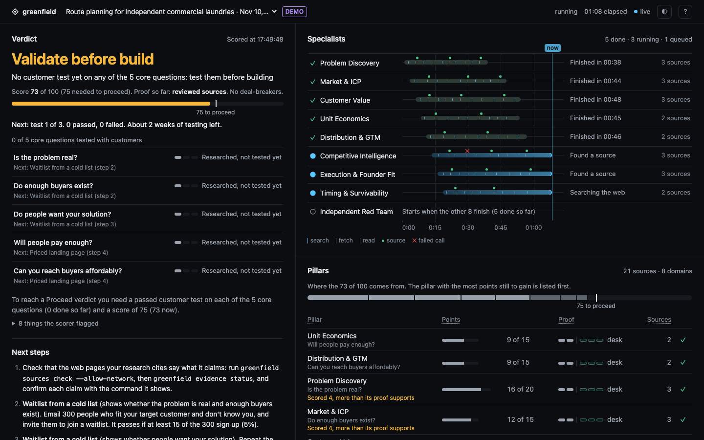

# Greenfield Business Evaluator

[](https://github.com/aarongbaker/greenfield-business-evaluator/actions/workflows/ci.yml) [](LICENSE) [](https://www.python.org/downloads/)

Research-first due diligence for business ideas, run inside **Claude Code** or **Codex** before any code is written.

Greenfield Business Evaluator is an [Agent Skill](https://agentskills.io/specification) that turns your coding assistant into a structured diligence team. Eight independent specialists research the idea, a red team challenges their findings, and a deterministic scorer produces a go/no-go recommendation backed by an auditable evidence trail.



## Why this one

- **A deterministic scorer.** The same `evaluation.json` always gives the same verdict, and anyone can re-run it. The model writes the research; it does not grade itself.
- **An evidence trail.** Every claim links to a source, sources can be checked against the quoted text, and real customer behavior goes into a tamper-evident ledger that a person signs off at a terminal.
- **Everything local.** No account, no API keys, no telemetry. Your idea never leaves your machine except through the web searches your assistant runs.

## Requirements

- Python 3.11+, standard library only
- macOS, Linux, or WSL on Windows
- Claude Code or Codex, ideally with web search enabled

## Installation

**Claude Code plugin** (skill and the nine research roles, no hooks). The plugin does not install the `greenfield` command, so also run the pipx line below:
```text
/plugin install greenfield-business-evaluator --marketplace aarongbaker/greenfield-business-evaluator
```
**pipx or uvx:**
```bash
pipx install git+https://github.com/aarongbaker/greenfield-business-evaluator  # needs-network
uvx --from git+https://github.com/aarongbaker/greenfield-business-evaluator greenfield doctor  # needs-network
```
**From a clone, no packages** (`install.py`):
```bash
git clone https://github.com/aarongbaker/greenfield-business-evaluator.git  # needs-network
cd greenfield-business-evaluator  # needs-clone
python3 install.py --platform both --scope project --project ../your-repo  # needs-clone
```
Check that `python3 --version` reports 3.11 or later; on Windows, use WSL. From a clone without pipx, run `python3 .claude/skills/greenfield-business-evaluator/scripts/greenfield.py` (or `.agents/skills/...` for Codex-only installs) wherever the docs say `greenfield`. User-scope installs, upgrades, `--dry-run`, uninstall and the install locations are in [docs/install.md](docs/install.md).

## Quickstart

Run these from the root of the repository where the research should live:
```bash
greenfield install --platform both --gitignore
greenfield doctor
greenfield start --idea "AI bookkeeping for dental practices"
greenfield score
greenfield dashboard --open
```

`install` puts the skill and research roles into `.claude/` and `.agents/`, `doctor` checks the setup, and `start` creates `research/greenfield/<slug>/` with a dated `evaluation.json`. Scoring before any research gives **Research incomplete**, which is the honest answer at that point. Now ask your assistant to do the research, then run `greenfield score` again:

**Claude Code**
```text
/greenfield-business-evaluator Evaluate [your idea]. US market, B2B, deep research. Use parallel specialists and red-team the evidence. Do not write code.
```

**Codex**
```text
$greenfield-business-evaluator Evaluate [your idea]. Research the market live, challenge competitors and economics, and recommend whether to validate, pivot, or run a bounded pilot. No implementation.
```

You can pass a one-line idea or point the skill at a PRD or README. Choose a depth of `quick`, `standard` (default), or `deep`. If the skill does not appear, restart the assistant. The skill proposes outreach and paid experiments but never spends money, contacts people, or launches anything on its own. Without web access it marks research as incomplete rather than inventing answers. To get from the first verdict to Proceed with your own materials, experiments and receipts, follow [the founder journey](docs/founder-journey.md).

### Output

```text
research/greenfield/<slug>/
├── DECISION.md          Verdict, scorecard, red-team dissent and next bet
├── MARKET_RESEARCH.md   Pillar findings, competitors, sizing, business model
├── EVIDENCE.md          Every material claim with its source
├── EXPERIMENTS.md       Falsifiable tests with stop conditions
├── evaluation.json      Reproducible inputs and pillar scores
└── decision.json        Deterministic scorecard output
```

On a terminal, `greenfield score` prints a one-screen summary (JSON when piped or with `--json`):

```text
● RESEARCH INCOMPLETE   AI bookkeeping for dental practices · as of 2026-11-03
Research incomplete: 8 of 8 pillars unassessed, no live web research

Pillar         Wt  Quality         Evidence    Profile general
problem        20  — not assessed  ░░░░░ 0
...
Next: Ask your assistant to finish the research, then run `greenfield score`.
```

## How it works

### Specialist roles

| Role | Agent |
|---|---|
| Problem Discovery | `gf-problem` |
| Market & ICP | `gf-market` |
| Customer Value | `gf-value` |
| Unit Economics | `gf-economics` |
| Distribution & GTM | `gf-distribution` |
| Competitive Intelligence | `gf-competition` |
| Execution & Founder Fit | `gf-execution` |
| Timing & Survivability | `gf-timing` |
| Independent Red Team | `gf-redteam` |

By default the specialists run in two waves of up to four concurrent tasks, followed by the red team. The orchestrator writes all final files to avoid contention.

### Scoring

Each pillar gets a 0 to 5 **quality** score and a 0 to 5 **evidence** score. Quality is how good the house looks in the listing; evidence is whether you have had it inspected. Scores are heuristics, not probabilities of success; weights, profiles and gates are in [docs/how-scoring-works.md](docs/how-scoring-works.md). The verdict is one of:

| Verdict | Meaning |
|---|---|
| Research incomplete | Not a launch decision yet |
| No go | A confirmed fatal blocker overrides the score |
| Pivot | Evidence shows a severe core weakness |
| Validate before build | Run the next experiment before writing code |
| Proceed to bounded pilot | Core gates met. Pilot only, not scale |

## Mission Control

Mission Control is an optional local dashboard that shows specialist activity, sources, warnings and the current verdict. It observes; it does not run agents, read their reasoning, or send data anywhere. Its files live in `.greenfield-observe/`, are private (0600) by default, and `greenfield install --gitignore` offers to add that folder to `.gitignore`. Run `greenfield demo` for a clearly labelled sample, then `greenfield dashboard --open`; setup and hooks are in [docs/mission-control.md](docs/mission-control.md). To have your assistant run this evaluation whenever a new project is proposed, see [Enforcing diligence](docs/install.md#enforcing-diligence-before-new-builds).

## Development

```bash
python3 -m unittest discover -s tests  # needs-clone
python3 skill/scripts/greenfield.py score skill/assets/evaluation-template.json  # needs-clone
```

The second command should print Research incomplete. CI (the badge above) also checks that generated files are fresh (`tools/make_agents.py`, `tools/gen_cli_docs.py`, `tools/screenshot.py`, each with `--check`) and runs every command in this README and `docs/` in a fresh repository with the network blocked. Tests use synthetic fixtures, not live web research.

## Limitations

- Source checks are lexical, not semantic fact verification. PDFs and paywalled sources need human review.
- The experiment ledger detects tampering with individual records, but an attacker with full file access can replace an entire chain. Behavior receipts are HMAC-signed with a local key after a person types a confirmation code at a terminal; signing raises the cost of forgery, it is not proof.
- Research needs the host's web browsing; without it every run ends as Research incomplete. Your agent host must also be allowed to run the research roles. Native subagent support varies by host version and can be disabled; the skill then falls back to sequential execution and says so.
- macOS, Linux and WSL only. On native Windows, commands that lock files refuse to run.
- This tool structures and audits research. It does not replace talking to customers.
- **How much to trust Proceed.** You attest your own receipts. The kind, `--as` type and `--result` are what you declare. Anything with shell access can sign, and `confirm_via` is self-reported, so it catches only accidental injection. An agent can also drive the real CLI under a pseudo-terminal (`script`, `unbuffer`, `expect`, python `pty`), read the one-time code and type it back, which records a genuine `confirm_via: tty`: the code proves a terminal, not a human. Quality, profile, claims and blockers can be changed by hand; every change is shown on each score, not stopped, and Proceed still needs receipts that support every quality above 3. Re-typed or re-exported data, splits under different experiment ids and re-saved binary files are not detected as reuse. A whole run folder copied into another project under the same slug is not detected. A one-word swap within `ledger reidea`'s 10-character allowance (dental to veterinary) is printed, not refused. Someone who deletes both `evaluation_id` and `quality-history.jsonl` can get a copied pre-wave ledger marked `legacy: true`. Source review covers only linked URL facts, and nothing ages evidence. Threat model, what is not defended, and how to report a vulnerability: [SECURITY.md](SECURITY.md).

## Learn more

- [docs/](docs/): [founder journey](docs/founder-journey.md), [install](docs/install.md), [commands](docs/cli.md), [how scoring works](docs/how-scoring-works.md), [Mission Control](docs/mission-control.md), [evidence and the ledger](docs/evidence.md), [comparing ideas](docs/portfolio.md), [troubleshooting](docs/troubleshooting.md)
- [CHANGELOG.md](CHANGELOG.md) and [SECURITY.md](SECURITY.md)

## License

[MIT](LICENSE)
