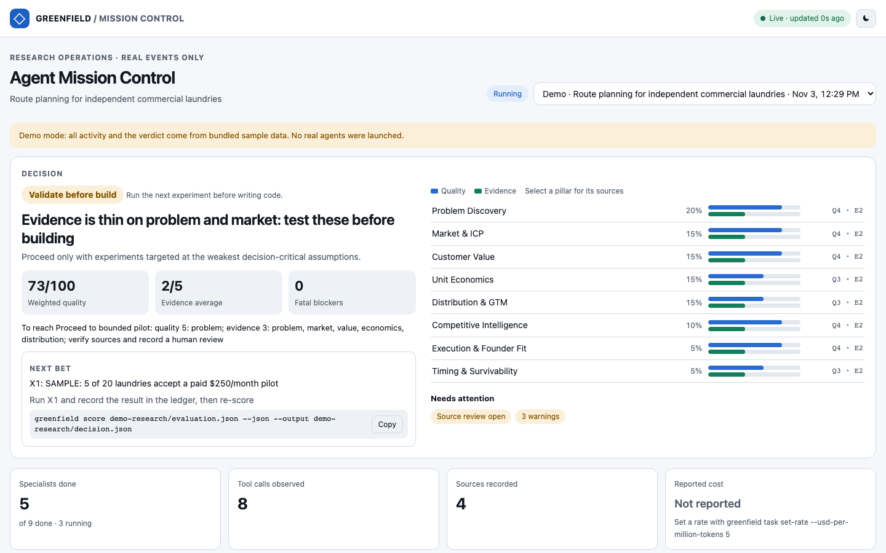

# Mission Control

Mission Control is a local dashboard for a research run. It shows the current verdict, which specialists started and finished, the tools and sources they used, task checkpoints and warnings. It is passive: it displays only events that really happened. It does not run agents, read their reasoning, verify citations, or invent progress percentages or costs.



## Try it with the demo

```bash
greenfield demo
greenfield dashboard --open
```

The demo creates a sample run from bundled data and labels it `DEMO` everywhere, so it cannot be mistaken for a real evaluation. It never replaces a real run that is in progress. Press Ctrl-C to stop the dashboard.

## Watch a real run

1. Install the skill and, optionally, the hooks (see [Install](install.md#hooks-for-mission-control)), start a run before you ask the assistant to research, and open the dashboard in a second terminal. Restart the assistant after installing hooks.

```bash
greenfield install --platform both --gitignore
greenfield hooks install --platform both
greenfield start --idea "Route planning for independent laundries" --new
greenfield dashboard --open
```

2. Invoke the skill in Claude Code (`/greenfield-business-evaluator ...`) or Codex (`$greenfield-business-evaluator ...`) in the same repository. The dashboard refreshes about every 1.5 seconds and keeps your scroll position and focus.

`start` refuses while another real run is active; `--new` replaces it. The Decision panel at the top re-scores the run's `evaluation.json` every time, so it always shows the verdict the scorer would give, not what an agent wrote.

The dashboard listens only on `127.0.0.1` and answers only the `Host` names `127.0.0.1:<port>` and `localhost:<port>`; anything else gets 421. Use `--port` to pick another port. Behind port forwarding or a tunnel that rewrites `Host`, add `--allow-host NAME`, and only on networks you trust. Do not expose the port through a public proxy.

## What the hooks see

Hooks cover `SubagentStart`, `SubagentStop`, `PreToolUse` and, in Claude Code only, `PostToolUseFailure`. They record only `gf-*` specialist names, event types and tool categories. They do not store tool inputs, page contents, agent text, prompts, reasoning, secrets, file contents or error messages. Without hooks, or when the host runs in the cloud, there is no live specialist feed; task checkpoints and the Decision panel still work.

`hooks install` also adds a PreToolUse guard that refuses agent attempts to record human attestations in the ledger. Remove all of Greenfield's hooks, and nothing else, with:

```bash
greenfield hooks remove --platform both
```

## Codex JSONL instead of hooks

`codex exec --json` prints a JSONL event stream that Mission Control can read:

```bash
codex exec --json "\$greenfield-business-evaluator Evaluate a business idea" | greenfield ingest-codex  # needs-agent
```

Run `greenfield start` first. The adapter stores event names, tool categories and reported token counts, not commands, prompts or messages. Events without a recognised specialist are shown as the orchestrator. Use `set -o pipefail` if you need Codex's own exit code.

## Task checkpoints and cost

The orchestrator records each specialist task as it claims and completes it, so an interrupted run can resume without redoing fresh work:

```bash
greenfield task claim --role gf-market
greenfield task resume --freshness-hours 72
greenfield status
```

`greenfield task complete --role gf-market --artifact <file>` is run only after a real report is saved. Agents may also record a `source_seen` or `artifact_created` event with `greenfield event emit`; a recorded source is not a verified one.

Cost stays "Not reported" unless the host reports tokens and you set your own blended rate. It is an estimate, not a bill:

```bash
greenfield task set-rate --usd-per-million-tokens 5
```

## Where the data lives

- Everything is in `<repo>/.greenfield-observe/`: one folder per run under `runs/` with `events.jsonl`, `meta.json` and `task-manifest.json`, and `active.json` naming the active run.
- Folders are 0700 and files 0600. `greenfield install --gitignore` offers to add `.greenfield-observe/` to your `.gitignore` (so does `greenfield doctor --fix`), keeping the folder out of git. Even metadata can reveal what you are researching, so treat it as private.
- Source URLs have query strings and fragments removed; local and private-network URLs are rejected.
- An agent that sends nothing for five minutes is shown as `quiet`, not failed. `queued` means a role that has not been seen starting, not a scheduled job.

## Limits

One active run per project. There is no remote sharing, access control or team view, and Claude Code token cost is not integrated yet. Hook formats follow the [Claude Code hooks](https://code.claude.com/docs/en/hooks) and [Codex hooks](https://learn.chatgpt.com/docs/hooks) documentation as checked on 23 October 2026.
